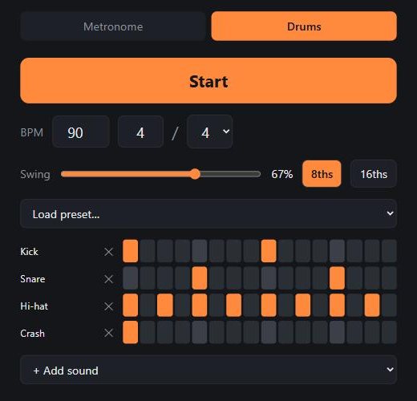

# Groovebox 🥁

A free, browser-based metronome and drum machine. No install, no ads, no tracking.

**Live demo:** https://purannepal.github.io/groovebox/



## Features

**Metronome**

- Editable BPM from 20 to 300, with − and + buttons
- Tap tempo by button or the Space key
- Any time signature from 1 to 16 beats over 2, 4, 8 or 16
- Per-beat accents: Strong, Medium, Soft or Off
- Drift-free scheduling on the audio clock

**Drum Machine**

- Editable 16th-step grid
- Swing from 50% to 75%, applied to 8ths or 16ths
- Five presets: Rock, Metal, Blues Shuffle, Hip-Hop and 7/8
- 11 synthesised sounds, with rows you can add or remove
- Tempo and time signature independent of the metronome

Settings are remembered in the browser.

## Run locally

```sh
npm ci
npm run dev
npm run check
```

`npm run check` runs Prettier, ESLint, the TypeScript compiler, the tests and a production build.

## How it was built

Groovebox was built with Claude Code and the Superpowers plugin, as an exercise in an agentic AI workflow:

1. **Brainstorming** with mockups, then a written [design spec](docs/superpowers/specs/2026-10-27-groovebox-design.md).
2. **Builder check:** a subagent reviewed the spec. It caught that 16th-only swing cannot produce a blues shuffle, so swing can now be set on 8ths or 16ths.
3. An [implementation plan](docs/superpowers/plans/2026-10-27-groovebox.md) of 12 test-first tasks.
4. **Subagent-driven development:** a fresh implementer for each task and a separate reviewer for each task. Reviewers caught a scheduler test that could never fail, an inaudible hip-hop swing and a shared-preset mutation bug.
5. **Manual checks:** the owner verified the audio by ear on the metronome and drum machine pull requests.
6. **CI** on every pull request.

The work landed in four feature [pull requests](https://github.com/PuranNepal/groovebox/pulls?q=is%3Apr+is%3Aclosed), plus one for the spec and plan.

## Tech

Vite, TypeScript (strict), Vitest, ESLint, Prettier, the Web Audio API, GitHub Actions and GitHub Pages. There are no runtime dependencies.

## License

[MIT](LICENSE)
